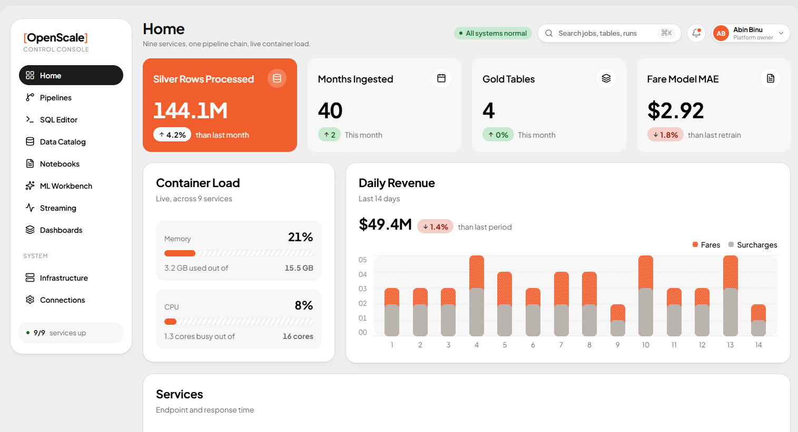

# OpenScale



A self-hosted data-platform console, the thing you'd reach for instead of
Databricks. One UI covers pipelines, a SQL editor, a data catalog,
streaming, dashboards, an ML workbench, notebooks, and the infrastructure
underneath them. All of it runs from one `docker compose up`.

Today it runs one real workload end to end: an NYC Yellow Taxi lakehouse
(Bronze → Silver → Gold → Features → Model) on Spark, MinIO, Postgres,
Redis and Kafka. The generic platform, meaning bring-your-own data,
connectors and a pipeline builder, is on the
[roadmap](ideas/vision-and-roadmap.md).

---

## Contents

- [Quickstart](#quickstart)
- [First run: load some data](#first-run-load-some-data)
- [Services, ports and logins](#services-ports-and-logins)
- [What's built](#whats-built)
- [Architecture](#architecture)
- [Observability](#observability)
- [Repo layout](#repo-layout)
- [Development](#development)
- [Troubleshooting](#troubleshooting)
- [Security](#security)
- [Design principles](#design-principles)

---

## Quickstart

**Prerequisites:** Docker with Compose v2+ and about **8 GB of free RAM**.
The stack idles at about 4 GB, and Spark jobs need more. Node.js 20+ and
Go 1.26+ are only needed if you want to run the frontend or control-plane
outside Docker.

```bash
git clone https://github.com/AZURIIEAL/openscale.git
cd openscale
docker compose up -d --build
```

The first build takes a few minutes, mostly the Spark worker image. Then:

```bash
docker compose ps                     # every service should be running
docker compose logs -f control-plane  # wait for "control-plane listening"
```

Open **http://localhost:5173**.

> If the build fails with `pip`/`npm`/`go` timeouts or DNS errors, your
> network doesn't get along with Docker's build network. Run
> `scripts/build-images.sh` then `docker compose up -d` instead. See
> [Troubleshooting](#troubleshooting).

To stop it:

```bash
docker compose down      # stop, keep all data
docker compose down -v   # stop and delete every volume (Postgres, MinIO, Redis, Grafana, Prometheus)
```

## First run: load some data

A fresh stack starts with an empty lake, so Home, Dashboards and the SQL
Editor have nothing to show yet. Open **Pipelines** and run the stages in
order, or use **Run All**, which chains them:

| # | Stage | What it does | Needs |
|---|---|---|---|
| 1 | **Ingest (Bronze)** | Downloads NYC TLC Parquet for a month range, validates the schema, writes to MinIO | A month range, e.g. `2024-07` → `2024-12`; internet access |
| 2 | **Validate (Silver)** | Rejects, quarantines or flags bad rows, writes clean trips | Bronze |
| 3 | **Aggregate (Gold)** | Daily revenue, hourly demand, zone stats and congestion, in MinIO and Postgres | Silver |
| 4 | **Compute Features** | Zone × hour features, to Postgres (offline) and Redis (online) | Silver |
| 5 | **Train Fare Model** | Trains a fare-prediction model and logs it to MLflow | Silver |

Each run streams its status and logs live. After Gold, the Home and
Dashboards screens fill in. After Silver, **Streaming → Replay** can push
real trips through Kafka.

To start over, **Pipelines → Clear data (Postgres + MinIO)** wipes Bronze, Silver and Gold
and the Gold/feature tables, but keeps job history.

## Services, ports and logins

Everything binds to `localhost`. The credentials are **local development
defaults**. Change them before exposing anything (see [Security](#security)).

| Service | URL / address | Login |
|---|---|---|
| **OpenScale console** | http://localhost:5173 | none |
| Control-plane API | http://localhost:8080 (`/healthz`, `/metrics`, `/api/*`) | none |
| Grafana | http://localhost:3000 | `admin` / `admin`; anonymous users can view |
| Prometheus | http://localhost:9090 | none |
| MinIO console | http://localhost:9101 | `minioadmin` / `minioadmin` |
| MinIO S3 API | http://localhost:9000 | same |
| JupyterLab | http://localhost:8888/lab?token=openscale-dev | token `openscale-dev` |
| MLflow | http://localhost:5000 | none |
| Postgres | `localhost:5432`, db `openscale` | `openscale` / `openscale` |
| Redis | `localhost:6379` | none |
| Kafka | `localhost:29092` (in-network: `kafka:9092`) | none |

The Postgres, Redis and Kafka exporters have no host ports. Only
Prometheus reads them.

## What's built

Every screen below is backed by a real control-plane endpoint or an
embedded real service, not mock data. The caveats are the real limits.

| Screen | What's real | Limits |
|---|---|---|
| **Home** | Live container CPU/memory gauges, job history, Gold-backed revenue trend and stat cards | |
| **Pipelines** | Triggers the real job queue end to end (control-plane → Redis → worker → Postgres), live status and logs over WebSocket, run-all chaining, cancel-all, clear data | Spark jobs can't be cancelled mid-run, so cancel restarts the worker container |
| **SQL Editor** | Read-only `SELECT`/`WITH` against Postgres (Gold tables, feature table, job history) inside a read-only transaction, schema browser, query history | Postgres only; Bronze/Silver Parquet in the lake isn't queryable yet |
| **Data Catalog** | Postgres schema browser (row counts and sample rows) and a live MinIO lake browser (object counts and sizes per layer) | Lineage is a static diagram of the five stages, not computed; no Parquet preview |
| **Streaming** | `replay` streams real Silver trips onto Kafka; the control-plane tails the topic and pushes live trips and windowed aggregates over WebSocket. Pause, resume, cancel and ×1–×10 speed act on the running replay | One topic, `yellow-taxi-trips` |
| **Dashboards** | Gold-layer charts: daily revenue, hourly demand, top zones, congestion, ETL health. Chart style and theme can be re-skinned | Fixed set of charts, no custom builder |
| **ML Workbench** | Embedded MLflow, tracking the same store the `train` job logs to | |
| **Notebooks** | Embedded JupyterLab, opened on three example notebooks | |
| **Infrastructure** | Docker inspection of nine services, with start/stop/restart | |
| **Settings** | Theme, accent, chart style and 12 interface skins, saved to Postgres | |
| **Search (⌘K / Ctrl+K)** | Live search across screens, job types, Postgres tables and recent runs; picking a result opens that item directly | |

**Not built yet:** generic connectors, a config-driven pipeline builder,
scheduling, and auth. See [`ideas/vision-and-roadmap.md`](ideas/vision-and-roadmap.md).

## Architecture

```
┌──────────────┐  HTTP + WebSocket  ┌────────────────────┐  Docker Engine API  ┌──────────────────┐
│   frontend   │ ─────────────────▶ │   control-plane    │ ──────────────────▶ │  Docker daemon   │
│ React · Vite │ ◀───────────────── │   Go · chi · :8080 │                     │ (sibling         │
│    :5173     │                    │                    │                     │  containers)     │
└──────────────┘                    └─────────┬──────────┘                     └──────────────────┘
                                              │ Postgres · Redis · Kafka · MinIO
                                              ▼
```

**The browser only talks to the control-plane.** The frontend never
reaches Postgres, Redis, Kafka, MinIO or Docker directly. Every data source
sits behind the Go control-plane's HTTP/WebSocket API. Inside the
control-plane, each backend has its own package (`internal/db`,
`internal/redis`, `internal/streaming`, `internal/lake`, `internal/docker`),
and no other package imports that backend's SDK.

**Long-running work goes through a queue.** The control-plane never runs
Spark itself. It records the run and enqueues it:

```
POST /api/jobs/{type}/run
  └─▶ control-plane: INSERT job_runs (queued) ─▶ XADD openscale:jobs:requests
                                                        │
                          worker (Python/PySpark) ◀─────┘ XREADGROUP
                            ├─ writes Bronze/Silver/Gold Parquet ─▶ MinIO
                            ├─ writes Gold + feature tables ─────▶ Postgres
                            ├─ replay job produces trips ────────▶ Kafka
                            ├─ final status + full log ──────────▶ Postgres job_runs (system of record)
                            └─ live status/log events ───────────▶ Redis pub/sub openscale:jobs:events
                                                                        │
            browser ◀── WebSocket /api/ws/jobs/{id} ◀── control-plane hub ◀┘

Kafka yellow-taxi-trips ─▶ control-plane consumer ─▶ windowed aggregates ─▶ WebSocket /api/streaming/ws
```

The details live in the component READMEs:
[control-plane](control-plane/README.md) · [worker](worker/README.md) ·
[frontend](frontend/README.md).

## Observability

Prometheus scrapes every part of the stack every 15s, and Grafana comes
provisioned with the datasource and two dashboards in an **OpenScale**
folder.

| Prometheus job | Source | Main metrics |
|---|---|---|
| `control-plane` | `control-plane:8080/metrics` | `openscale_http_requests_total`, `openscale_http_request_duration_seconds` (per chi route pattern), `openscale_job_runs{job_type,status}` (read from Postgres at scrape time), Go runtime |
| `postgres` | `postgres-exporter` | `pg_up`, database size, connections, commits/rollbacks, tuple reads/writes |
| `redis` | `redis-exporter` | memory, clients, commands by type, keys |
| `kafka` | `kafka-exporter` | brokers, per-topic offsets (messages/s) |
| `minio`, `minio-bucket` | MinIO's built-in `/minio/v2/metrics/*` | lake size and objects, S3 requests/errors/traffic, health |
| `prometheus` | itself | |

Dashboards:

- **OpenScale · Control plane & pipelines**
  (http://localhost:3000/d/openscale-control-plane): API request rate,
  5xx %, p95 latency per route, runtime stats, and job runs by type and
  status.
- **OpenScale · Infrastructure**
  (http://localhost:3000/d/openscale-infrastructure): up/down per backend,
  then MinIO, Postgres, Redis and Kafka sections.

The config lives in [`observability/`](observability/): the scrape config
is in `prometheus/prometheus.yml`, and the datasource and dashboard JSON
are in `grafana/provisioning/`. Dashboards are loaded from files, so to
change one permanently, edit the JSON (or export it from Grafana into
that folder) and run `docker compose restart grafana`.

## Repo layout

```
control-plane/   Go API: cmd/server + internal/{api,config,db,docker,health,jobs,lake,metrics,redis,streaming,ws}
frontend/        React 19 + TypeScript + Vite console, one DDD-style domain per screen
worker/          Python job worker: Spark ETL (ingest/silver/gold/features/train), Kafka replay, reset
jupyter/         JupyterLab image (embedded by the Notebooks screen)
notebooks/       The example notebooks JupyterLab opens
observability/   Prometheus scrape config + Grafana datasource/dashboards
scripts/         Helper scripts (build-images.sh)
ideas/           Vision, roadmap, and tech-stack decision records
etl-exposure/    The original standalone taxi pipeline: reference/legacy, nothing imports it
docs/            README assets
docker-compose.yml   The whole stack as one "openscale" compose project
```

## Development

| Component | Run it | Docs |
|---|---|---|
| Frontend | Runs in Docker with hot reload already; or `cd frontend && npm install && npm run dev` after `docker compose stop frontend` | [frontend/README.md](frontend/README.md) |
| Control-plane | `cd control-plane && go run ./cmd/server` after `docker compose stop control-plane` | [control-plane/README.md](control-plane/README.md) |
| Worker | Rebuild after changes: `docker compose up -d --build worker` | [worker/README.md](worker/README.md) |

The frontend container bind-mounts `./frontend`, so UI edits hot-reload
with no rebuild. Go and Python changes need their image rebuilt.

Two lists are kept in sync by hand:

- **Job types**: `jobs.Catalog` in
  [control-plane/internal/jobs/jobs.go](control-plane/internal/jobs/jobs.go),
  `JOB_TABLE` in [worker/main.py](worker/main.py), and `JOB_CATALOG` in
  [frontend/src/domains/pipelines/domain/entities.ts](frontend/src/domains/pipelines/domain/entities.ts)
  (which leaves out `replay` and `reset` on purpose).
- **Routes**: [frontend/src/app/router.tsx](frontend/src/app/router.tsx) and
  [frontend/src/shared/layout/navigation.ts](frontend/src/shared/layout/navigation.ts).

## Troubleshooting

**`pull access denied for minio/minio`.** MinIO stopped publishing public
images. The compose file already uses the community builds `pgsty/minio`
and `pgsty/mc`. Pull the latest repo.

**Build fails with `Read timed out` (pip), `ETIMEDOUT` (npm) or
`dial udp ... network is unreachable` (go).** Containers can't reach the
internet reliably during the build, usually because of an MTU or IPv6
mismatch between Docker's bridge network and your connection. Build
on the host's network instead:

```bash
scripts/build-images.sh            # all images; or name some: scripts/build-images.sh worker
docker compose up -d               # no --build, so compose uses those images
```

(Adding `network: host` to the compose file doesn't help: Compose builds
through Buildx Bake, which refuses host networking without an `--allow`
flag that `docker compose` can't pass.)

**A port is already in use.** Change the left side of that service's
`ports:` mapping in `docker-compose.yml`. If you move the control-plane or
frontend ports, update `VITE_API_BASE_URL` and `FRONTEND_ORIGIN` to match.

**A Spark job dies or the worker restarts mid-job.** Spark's driver gets
`SPARK_DRIVER_MEMORY=6g` by default (set on the `worker` service). Lower it
on a smaller machine, or ingest fewer months at once.

**Home and Dashboards are empty.** You haven't run Gold yet. See
[First run](#first-run-load-some-data).

**A Grafana dashboard says "No data" everywhere.** Check that its targets
are up at http://localhost:9090/targets. A tab opened before a dashboard
was renamed or removed keeps showing the old layout; reload it.

**Don't run `etl-exposure/docker-compose.yml` at the same time.** It uses
the same container names.

## Security

OpenScale has **no authentication**. It assumes the only person who can
reach it is the one running it. The console can start and stop containers
(it mounts the Docker socket), wipe the lake, and run code through
Jupyter, and every bundled service uses a default password.

Before putting it anywhere other than `localhost`:

1. Put an auth layer in front of it, e.g. Cloudflare Tunnel + Cloudflare
   Access, an OAuth proxy, or a VPN such as Tailscale.
2. Change the default credentials for Postgres, MinIO, Grafana and the
   Jupyter token.
3. Don't publish the infrastructure ports (5432, 6379, 9000, 29092, …) to
   the internet.

## Design principles

- **Domain-driven structure.** Each frontend screen is a self-contained
  domain (`domain/`, `application/`, `infrastructure/`, `ui/`). The Go
  backend separates transport (`internal/api`) from adapters
  (`internal/docker`, `internal/db`, …) from pure domain types
  (`internal/health`, `internal/jobs`).
- **Dependency inversion.** Frontend hooks depend on gateway interfaces
  they own, never on a concrete HTTP client. Switching a domain from mock
  to real is a one-line change.
- **One package per external system.** Only `internal/redis` imports
  go-redis, only `internal/docker` imports the Docker SDK,
  `internal/streaming` kafka-go, `internal/lake` minio-go, and
  `internal/metrics` the Prometheus client.
- **No fake data in real screens, and no fake controls on real data.** A
  screen either has a real backend behind it, or it says it doesn't.
- **`etl-exposure/` is read-only history.** Copy logic out of it when a
  platform feature needs it; never import from it.

## Further reading

- [`ideas/vision-and-roadmap.md`](ideas/vision-and-roadmap.md): product vision and phased roadmap, with current status
- [`ideas/tech-stack.md`](ideas/tech-stack.md): why each technology was picked, and where the build ended up differing
- [`ideas/brainstorm.md`](ideas/brainstorm.md): the original idea list
- [`etl-exposure/README.md`](etl-exposure/README.md): the standalone pipeline OpenScale grew out of
